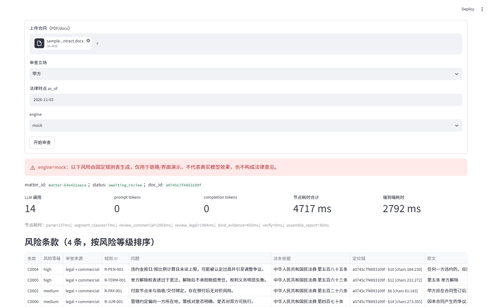
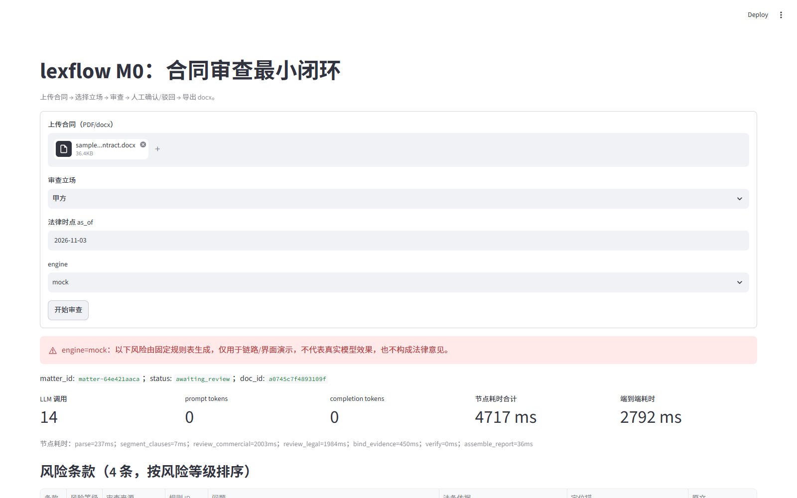

# 合同审查智能体：LangGraph 流水线 · 条款级风险 · 原文溯源

一个可运行的合同审查多智能体最小工程（M0）。主推理可走 OpenAI 兼容 API（DeepSeek/Qwen 均可），**没有 API key 时整条链路用确定性 mock 跑通**，所有产物显式标注 `engine=mock`。

> 本项目是工程原型，**不是法律意见**。仓库内**没有任何实测的法律效果准确率、通过率或线上指标**；`eval` 只输出本次运行的原始计数与比率（如条款数、召回率），mock 引擎下的数字只反映链路是否跑通，不代表模型能力。
>
> 每个数字的来源与性质见 [§4 实测数字与来源](#4-实测数字与来源)。凡是「合成数据 / mock / 单次运行」的结论，都不能外推到真实合同或真实模型。

---

## 1. 快速开始

要求：Python >= 3.11，已安装 [uv](https://docs.astral.sh/uv/)。

```powershell
# 安装依赖（含 dev 依赖）
uv sync

# 可选：本地 embedding（未安装时自动退化为 BM25-only）
uv sync --extra local-embed

# 可选：扫描件 OCR（未安装时遇到扫描件会抛明确错误）
uv sync --extra ocr
```

### 1.1 一条命令演示（推荐先跑这个）

```powershell
uv run python scripts/demo.py
```

全程离线、不需要 API key，依次完成：上传示例 → mock 分析 → 风险清单（按等级排序，含规则 ID、法条依据、定位锚）→ 人工确认 → 导出 docx → 打印耗时 / token / 节点统计。
演示脚本与 CLI/API/UI 共用 `AnalyzeService`；3–5 分钟讲法与追问应对见 [docs/DEMO.md](docs/DEMO.md)。

变体：

```powershell
uv run python scripts/demo.py --file examples/sample_procurement_contract.pdf --stance 乙方
uv run python scripts/demo.py --show-logs          # 保留 JSON 日志，便于讲可观测
$env:LEXFLOW_EMBEDDING_ENABLED="false"; uv run python scripts/demo.py   # 强制 BM25-only，启动更快
```

### 1.2 CLI（无 API key 端到端）

```powershell
# 交互模式：默认在导出前 interrupt() 等待单人确认
uv run python -m lexflow.cli analyze examples/sample_service_contract.docx --engine mock

# 自动化模式：跳过交互确认
uv run python -m lexflow.cli analyze examples/sample_service_contract.docx --engine mock --auto-approve
uv run python -m lexflow.cli analyze examples/sample_procurement_contract.pdf --engine mock --auto-approve

# 按 matter_id 查看本次分析的节点耗时 / token / 检索模式
uv run python -m lexflow.cli timeline matter-xxxxxxxxxx
```

### 1.3 HITL 中断 / 恢复（跨进程）

```powershell
# 第 1 次进程：interrupt 停在 awaiting_review，写出 artifacts/hitl_demo_state.json
uv run python scripts/hitl_demo.py start

# 第 2 次进程：新 AnalyzeService 从 SqliteSaver checkpoint 恢复并导出 docx
uv run python scripts/hitl_demo.py resume
# 可选：resume --action reject 验证驳回不导出
```

### 1.4 API + UI

```powershell
# Docker（数据/模型挂载持久化，详见第 5 节）
docker compose up --build -d

# 或本地一键启动（新窗口分别启动 API 与 Streamlit）
powershell -ExecutionPolicy Bypass -File scripts/dev.ps1

# 或分开启动
uv run lexflow-api                     # http://127.0.0.1:8000/docs
uv run streamlit run lexflow/ui/app.py # http://127.0.0.1:8501
```

接口（`POST /analyze` 为任务化接口：立即返回 task_id，审查在后台线程执行）：

| 方法 | 路径 | 说明 |
|---|---|---|
| GET | `/health` | 引擎默认值、语料模式、法条数、检索模式（可能为 `indexing`）、`vector_ready`、向量后端/原因、embedding 设备；精排五项：`reranker_configured`（配置默认开）/ `reranker_model_found`（模型路径可解析，不加载权重）/ `reranker_available`（已加载可用）/ `reranker_device` 与 `reranker_reason`，外加启动预热状态 `reranker_warmup`（`running`/`ready`/`failed`/`skipped`）与 `reranker_warmup_s`。长任务运行期间该接口不被阻塞 |
| POST | `/analyze` | 上传 PDF/docx（白名单 + 大小上限 + 非空），**立即**返回 `task_id`/`matter_id`/`status=queued`/`token`（HTTP 202）。可选表单字段 `rerank=true/false`，省略则取 `LEXFLOW_RERANKER_ENABLED`；可选请求头 `Idempotency-Key`，同一键重复提交复用同一任务（HTTP 200 + `idempotent_replay=true`） |
| GET | `/tasks/{task_id}` | 任务状态：`queued`/`running`/`cancelling`/`awaiting_review`/`completed`/`rejected`/`failed`/`cancelled`/`interrupted`，含 `progress`（trace 中已完成的节点）、`error`（脱敏后的失败原因）与完成后的 `result`。需要 `X-Matter-Token` |
| POST | `/tasks/{task_id}/cancel` | 取消排队中/运行中的任务；取消后 matter 不再允许 review/export。协作式取消：只在任务开始前与图返回后生效，不强行中断正在执行的 LLM 调用 |
| POST | `/tasks/{task_id}/retry` | 只对 `failed`/`cancelled`/`interrupted` 任务生效，默认最多重试 1 次；达到上限返回 409 |
| POST | `/review/{matter_id}` | 单人确认，恢复 `interrupt()` 并导出 docx；已完成的 matter 重复 review 直接回放结果，不重复调用模型。需要 `X-Matter-Token` |
| GET | `/export/{matter_id}` | 下载 docx；需要 `X-Matter-Token`，浏览器下载可用 `?token=`。matter 已取消时返回 409 |

错误统一为 `{"error": {"code", "message"}}`，不返回堆栈、密钥或服务器绝对路径。默认 `LEXFLOW_API_REQUIRE_TOKEN=true`：`/review`、`/export`、`/tasks/*` 都要带 analyze 返回的 token，用来隔离他人 matter；单机无用户体系，token 即归属凭证。

Streamlit UI 为单页演示：上传合同 → 选立场/as_of/engine（默认 `mock`，零成本）→ 审查 → 风险表（按风险等级排序，含规则 ID、法条依据、**五闸状态、引用原文**、定位锚）→ 核验详情（G1–G5 逐条说明）→ 人工确认/驳回 → 下载 docx，并展示本次 LLM 调用次数、tokens、节点耗时与端到端耗时。`engine=mock` 时页面顶部显示红色横幅，明确这是固定规则演示、不是真实模型效果；后端未启动时页面给出明确提示而不是抛异常。`skipped` 显示为「未判定」：API 引擎的 G4 只确认存在引文，不校验法条适用性，不计入「五闸全过」。

#### 界面实拍（`engine=mock`）

以下截图来自本机真实运行：API 监听 `127.0.0.1:18000`、Streamlit 监听 `127.0.0.1:18501`，在界面上显式选择 `engine=mock`，上传 `examples/sample_service_contract.docx` 后点击「开始审查」，未调用任何真实 API。数字只反映该次链路是否跑通，不代表模型能力。



风险表按风险等级排序，包含规则 ID、法条依据与「定位锚」列；页面顶部保留 `engine=mock` 红色横幅。



同一次运行的成本/耗时区域：LLM 调用 14 次、prompt/completion tokens 均为 0（mock 不产生真实 token），节点耗时合计 4717 ms、端到端 2792 ms。

### 1.5 测试与评测

```powershell
# 离线回归（CI 同款）：不调用真实 LLM、不读付费 Key、不下载大模型
uv run python -m compileall -q lexflow eval tests scripts
uv run pytest -q -m "not live"

# live 分层：只有显式开启且有 Key 才跑，结果单独记录，不与离线通过率混写
$env:LEXFLOW_LIVE_API = "1"; uv run pytest -q -m live

uv run python scripts/build_corpus.py          # 重建 1465 条统一语料（幂等）
uv run python eval/run_eval.py
uv run python scripts/gen_synthetic_contracts.py
uv run python eval/run_synthetic_eval.py
uv run python eval/run_retrieval_eval.py       # 三档检索评测（dense / hybrid / hybrid+rerank）
uv run python eval/run_protocol_eval.py        # 独立评测协议：dev/test 分集、分指标、自审标注单列
uv run python eval/run_dual_eval.py            # 单路/双路对照 + 独有贡献 CSV
uv run python eval/run_citation_resolution_eval.py # 引用补证前后对照（mock + citation-blind，无付费调用）
```

CI 见 [.github/workflows/ci.yml](.github/workflows/ci.yml)：`offline` job 执行 `uv sync --frozen` + `compileall` + `pytest -m "not live"`；`docker` job 单独执行镜像构建。工具调用、HITL、G4/G5 三态、严格溯源与 reducer 反向用例都在离线回归里；live API、Docker、GPU 属于独立命令与独立报告。

### 1.6 mock 与真实 API 的区别

| 维度 | `engine=mock` | `engine=api` |
|---|---|---|
| 推理 | `lexflow/llm/mock.py` 中的确定性规则匹配，输出固定文本 | `lexflow/llm/openai_compat.py`，OpenAI 兼容协议 |
| token | 恒为 0（不调用模型） | 记录 prompt/completion token 原始计数 |
| 成本 | 0 | 仅当配置单价时估算，否则留空 |
| 产物标注 | 报告与 docx 中标注 `MOCK 演示`、`engine=mock` | 标注 `engine=api` 与模型名 |
| 用途 | 验证链路、回归测试、无 key 演示 | 真实抽取与审查（**效果未评测**） |

`engine=auto`（默认）：有 `LEXFLOW_API_KEY` 走 API，否则自动落到 mock。

### 1.7 环境变量

| 变量 | 默认值 | 说明 |
|---|---|---|
| `LEXFLOW_API_KEY` | 空 | 为空时只能 mock |
| `LEXFLOW_BASE_URL` | `https://api.deepseek.com` | OpenAI 兼容地址 |
| `LEXFLOW_MODEL` | `deepseek-chat` | 模型名 |
| `LEXFLOW_PRICE_INPUT_PER_M` | 空 | 输入单价（元/百万 token），不填不估算 |
| `LEXFLOW_PRICE_OUTPUT_PER_M` | 空 | 输出单价（元/百万 token） |
| `LEXFLOW_EMBEDDING_MODEL` | `$LEXFLOW_MODEL_DIR/bge-m3`（存在时）；否则 `BAAI/bge-small-zh-v1.5` | 本地 embedding 路径/模型名 |
| `LEXFLOW_MODEL_DIR` | 项目父目录的 `模型`（本机即 `E:\project\模型`） | 模型根目录；容器内为 `/models` |
| `LEXFLOW_DEVICE` | `auto` | 统一设备解析：`cuda` 可用则用，否则 `cpu`；embedding/reranker 都继承 |
| `LEXFLOW_EMBEDDING_ENABLED` | `true` | 关闭后直接 BM25-only |
| `LEXFLOW_EMBEDDING_DEVICE` | 继承 `LEXFLOW_DEVICE` | 单独覆盖 embedding 设备；服务链路建议显式设为 `cpu`（见 [§2.6](#26-检索与降级)） |
| `LEXFLOW_STATUTE_TOP_K` | `3` | 每个条款检索的候选法条数；默认 3，`10` 仅作对照实验的可选开关（见 [§4.5](#45-top-k-对照实验与结论2026-11)） |
| `LEXFLOW_EMBED_CACHE` | `data/embeddings` | 向量缓存目录 |
| `LEXFLOW_EMBED_RECOVER_RETRIES` | `3` | 向量层运行时故障的自愈预算：连续失败超过该次数才转终态 BM25-only（`0` = 一次失败即终态，等于旧行为） |
| `LEXFLOW_EMBED_RECOVER_COOLDOWN_S` | `30` | 两次自愈重建之间的冷却秒数，避免抖动时反复重建 |
| `LEXFLOW_RERANKER_ENABLED` | `false` | 新审查的**默认**是否启用精排；单次请求可用 `/analyze` 的 `rerank` 参数覆盖。模型能否加载由 `LEXFLOW_RERANKER_MODEL` 决定，与此开关无关 |
| `LEXFLOW_RERANKER_MODEL` | `$LEXFLOW_MODEL_DIR/bge-reranker-v2-m3`（存在时） | 本地 reranker 路径 |
| `LEXFLOW_RERANKER_DEVICE` | 继承 `LEXFLOW_DEVICE` | 单独覆盖 reranker 设备。有 CUDA torch 时**显式设 `cuda`**，同时把 embedding 固定为 `cpu`，避免两模型同卡 |
| `LEXFLOW_RERANKER_WARMUP` | `true` | 启动时后台加载精排模型，把 20s 加载从首问挪到启动；模型不存在或 `false` 时跳过。预热线程不阻塞服务启动，失败只记原因 |
| `LEXFLOW_DATA_DIR` / `LEXFLOW_ARTIFACTS_DIR` / `LEXFLOW_DB` | `data` / `artifacts` / `data/lexflow.db` | 路径 |
| `LEXFLOW_CORPUS` | `data/corpus/law_articles.jsonl` | 法条语料 |
| `LEXFLOW_FAILURES` | `data/failures.jsonl` | 失败归档路径 |
| `LEXFLOW_API_URL` | `http://127.0.0.1:8000` | Streamlit 访问的 API 地址 |
| `LEXFLOW_LOG_LEVEL` | `INFO` | JSON 行日志级别；demo 默认压到 `ERROR`，可 `--show-logs` 恢复 |
| `LEXFLOW_FALLBACK_MODELS` | 空 | 备用模型列表（逗号分隔）；主模型重试耗尽后按顺序切换 |
| `LEXFLOW_FALLBACK_API_KEY` | 空 | 仅用于 `LEXFLOW_FALLBACK_MODELS` 的备用 Key；与主模型绑定，不会在主模型上换 Key 重试。401/400 不重试 |
| `LEXFLOW_LLM_CONNECT_TIMEOUT_S` / `LEXFLOW_LLM_READ_TIMEOUT_S` | `10` / `120` | 连接与读取超时（秒） |
| `LEXFLOW_LLM_TOTAL_DEADLINE_S` | `180` | 单次调用总 Deadline；到点抛 `timeout`，不再继续重试 |
| `LEXFLOW_LLM_MAX_RETRIES` | `2` | 仅对 retriable 错误（429/5xx/超时/坏 JSON）做指数退避重试；401/400 不重试 |
| `LEXFLOW_LLM_MAX_CONCURRENCY` | `4` | 单进程内并发调用上限（信号量） |
| `LEXFLOW_RESOLVE_CITATIONS` | `true` | 是否对未引用 finding 走 Function Call + MCP 补证 |
| `LEXFLOW_RESOLVE_MAX_ROUNDS` / `LEXFLOW_RESOLVE_MAX_TOOL_STEPS` | `2` / `4` | 补证最多 2 轮工具调用（对应最多 3 次模型调用：2 次带工具 + 1 次收尾）、4 步工具调用 |
| `LEXFLOW_RESOLVE_MAX_FINDINGS` | `8` | 单次审查最多补证多少条 finding，超出部分如实记为 `skipped_budget` |
| `LEXFLOW_MCP_ENABLED` / `LEXFLOW_MCP_TIMEOUT_S` | `true` / `20` | 是否用真实 MCP 子进程暴露工具；启动失败时降级到进程内本地工具运行时 |
| `LEXFLOW_MAX_UPLOAD_BYTES` | `10485760` | 上传大小上限（默认 10 MiB） |
| `LEXFLOW_ALLOWED_EXTENSIONS` | `.pdf,.docx,.png,.jpg,.jpeg` | 允许的扩展名白名单 |
| `LEXFLOW_API_REQUIRE_TOKEN` | `true` | 是否要求 matter token；单机演示可设为 `false` |
| `LEXFLOW_TASK_WORKERS` / `LEXFLOW_TASK_MAX_RETRIES` | `2` / `1` | 后台任务线程数与单任务最大重试次数 |

项目根目录的 `.env` 会自动加载（已存在的系统环境变量优先，不会被覆盖；Docker Compose 也会读取同一文件做变量替换）。可直接复制 [.env.example](.env.example) 后填 key。`.env` 已在 `.gitignore` 与 `.dockerignore` 中排除，不会提交或打进镜像。

真实 API 示例（阿里云百炼 / DashScope，OpenAI 兼容端点）：

```powershell
# 复制 .env.example 为 .env，填入真实 key；或临时设置环境变量
$env:LEXFLOW_API_KEY = "sk-..."
$env:LEXFLOW_BASE_URL = "https://dashscope.aliyuncs.com/compatible-mode/v1"
$env:LEXFLOW_MODEL = "deepseek-v4.1-flash"
$env:LEXFLOW_PRICE_INPUT_PER_M = "2"
$env:LEXFLOW_PRICE_OUTPUT_PER_M = "8"
uv run python -m lexflow.cli analyze examples/sample_service_contract.docx --engine api --auto-approve
```

- 百炼北京地域的共享域名 `https://dashscope.aliyuncs.com/compatible-mode/v1` 仍可正常使用；生产环境可换成业务空间专属域名 `https://{WorkspaceId}.cn-beijing.maas.aliyuncs.com/compatible-mode/v1`。
- `deepseek-v4.1-flash` 是百炼正式模型 ID（2026-10-26 文档），也可用快照版本 `deepseek-v4.1-flash-1017`。
- 单价（元/百万 token）：闲时（东八区 22:00–次日 08:00）输入 1 / 输出 4；忙时输入 2 / 输出 8。上例按忙时上限填，属于保守估算。

> 注意：真实 API 模式下模型输出的可靠性、条款召回与引用准确率**尚未评测**，不能把 mock 的比率当作 API 效果。

---

## 2. 架构与节点

### 2.1 LangGraph 主图

```
START → parse → segment_clauses → ┬ review_legal
                                  └ review_commercial   （并行）
      → resolve_citations → bind_evidence → verify → assemble_report → export_docx → END
                                export_docx 内 interrupt() 单人确认
```

- checkpointer：`SqliteSaver`，与业务表**同一个 SQLite 文件、不同表**；中断后换进程仍可按 `matter_id` 恢复。
- 证据 reducer 按 `law_name#article_no` 去重，保留更高分；findings 按 `finding_id` 去重。
- `assemble_report` / `export_docx` 的耗能在图返回后由 service 写回，避免中断恢复后 metrics 缺尾节点。
- `resolve_citations` 只处理 `law_name/article_no` 为空的 finding；每条最多 2 轮工具调用、总计最多 3 次模型调用（2 次带工具 + 1 次收尾），工具步数最多 4 步。它只补法条字段，**不设置 `rule_id`**，因此 G4 不会因补证成功自动变成 pass。

### 2.2 目录结构

```
lexflow/
├── pyproject.toml / uv.lock
├── .github/workflows/ci.yml      # offline（pytest -m "not live"）+ docker build 两个 job
├── Dockerfile                   # 依赖 + 代码 + 模板；不含模型与数据
├── docker-compose.yml           # api + ui；./data、./artifacts、../模型 挂载
├── docker-compose.gpu.yml       # 可选 GPU 覆盖层（gpus: all + cu130 build arg）
├── docker/wheels/               # 可选：宿主机预下载的 CUDA torch wheel（*.whl 不入库）
├── .dockerignore
├── README.md
├── docs/PLAN.md                 # 盘点结论、数据替代策略、阶段计划与执行记录
├── docs/DEMO.md                 # 3–5 分钟演示脚本与追问应对
├── scripts/
│   ├── demo.py                  # 一条命令离线演示（mock）
│   ├── hitl_demo.py             # 跨进程 interrupt / resume 演示
│   ├── build_corpus.py          # 构建 1465 条统一语料
│   ├── make_samples.py          # 生成两份自造示例合同
│   ├── gen_synthetic_contracts.py # 生成合成合同 + 注入式 gold
│   └── dev.ps1                  # 一键启动 API + Streamlit
├── data/
│   ├── corpus/law_articles.jsonl # 1465 条法条（含 law_id/chapter_path/content_hash）
│   ├── corpus/labor_law_normalization.jsonl # 劳动法 107 条归一化前后记录
│   ├── corpus/corpus_manifest.json # 来源、条数、缺失元数据、文件 SHA256
│   ├── embeddings/              # bge-m3 向量缓存（运行后生成）
│   ├── synthetic/               # 合成合同、gold、manifest（生成后）
│   └── lexflow.db               # SQLite（业务表 + checkpoint 表，运行时生成）
├── assets/templates/risk_report.docx  # docxtpl 模板（自动生成）
├── artifacts/<matter_id>/       # 原文件副本与 report.docx（运行时生成）
├── examples/
│   ├── sample_service_contract.docx
│   └── sample_procurement_contract.pdf
├── eval/
│   ├── gold.jsonl               # 2 条自造标注
│   ├── run_eval.py              # 示例合同评测
│   ├── run_synthetic_eval.py    # 合成数据集评测（条款级 recall/precision）
│   ├── run_retrieval_eval.py    # 三档检索评测（对齐/剔除 + Recall@5/10）
│   ├── run_protocol_eval.py     # 独立评测协议：dev/test 分集、分指标、自审标注单列
│   ├── run_dual_eval.py         # 单路/双路对照 + 独有贡献 CSV
│   ├── public_templates/manifest.json # 公开模板分集清单（label_source=self_review）
│   └── results.* / synthetic_results.* / retrieval_results.* # 运行后生成
├── lexflow/
│   ├── config.py                # Settings（环境变量、模型目录）
│   ├── devices.py               # 统一 device 解析（cuda→cpu）
│   ├── logging.py               # JSON 行日志（含 trace_id contextvar；MCP 模式写 stderr）
│   ├── trace.py                 # 请求级 JSONL trace（脱敏、截断、线程安全）
│   ├── models.py                # Pydantic 模型
│   ├── corpus_build.py          # 1465 条语料构建 + 康熙部首归一化
│   ├── service.py               # CLI/API/UI/eval 共用服务层
│   ├── synthetic.py             # 合成合同生成器（固定种子 + 风险注入）
│   ├── cli.py
│   ├── api/main.py              # FastAPI（任务化 /analyze、/tasks、上传边界、matter token）
│   ├── api/tasks.py             # 单机任务管理（线程池 + SQLite 任务表 + 取消/重试/幂等）
│   ├── ui/app.py                # Streamlit 单页（轮询任务状态）
│   ├── parse/                   # PyMuPDF / pdfplumber / python-docx / 可选 OCR
│   ├── segment/segmenter.py     # 条款切分 + 类型判定（含 char/page/bbox）
│   ├── retrieval/               # corpus / bm25 / embedder / reranker / hybrid
│   ├── llm/                     # base / errors / mock / openai_compat / factory（超时/重试/降级）
│   ├── tools/                   # Function Call 工具声明、本地/ MCP 运行时、JSON-RPC 服务端
│   ├── review/reviewer.py       # 法务 ‖ 商务双路审查
│   ├── verify/gates.py          # G1–G5 纯函数
│   ├── storage/db.py            # SQLite 业务表 + tasks 表
│   ├── graph/                   # state / nodes / resolve / build（LangGraph 主图）
│   └── report/docx_export.py    # docxtpl 导出
└── tests/
    ├── conftest.py
    ├── test_segment.py          # 字符偏移不越界、PDF 保留 page/bbox
    ├── test_state_reducer.py    # 证据去重 reducer
    ├── test_gates.py            # 伪造条号 / 篡改引文 / 过期条文
    ├── test_e2e_mock.py         # mock 端到端、docx 行数 = DB findings、interrupt/resume
    ├── test_api.py              # /health 状态流转、任务化 /analyze、/review、/export、API 层 resume
    ├── test_api_tasks.py        # 任务状态、取消、有限重试、幂等键、/health 不被长任务阻塞
    ├── test_api_boundaries.py   # 扩展名/大小/空文件、路径穿越、token、错误脱敏、临时文件清理
    ├── test_citation_resolution.py # MCP 真实子进程、伪造引文拒引、步数/轮次上限
    ├── test_provider_governance.py # 429/401/400/500、总 Deadline、fallback、坏 JSON
    ├── test_trace.py            # 事件完整、trace_id 一致、脱敏与截断
    ├── test_live_api.py         # live 分层，默认跳过
    ├── test_synthetic.py        # 合成数据可复现、gold 一一对应、端到端
    └── test_corpus.py           # 1465/1260/107/98、哈希、归一化、幂等、降级
```

### 2.3 定位锚与页码（docx 不伪造页码）

- **PDF**：`parse` 用 PyMuPDF `page.get_text("blocks")` 取真实 `page_no` 与 `bbox`；条款的 `page_no` 直接来自该块所在页，不再按字符位置近似。
- **docx**：docx 文件格式本身不保存分页信息（分页由 Word 排版引擎在打开时决定，python-docx 读不到），因此**不推断页码**：`page_no` 置空，`Clause` / `Finding` 使用定位锚 `§段落号 [章节标题] [chars start:end]`（例如 `§3 第三章 违约责任 [chars 120:180]`），表格行使用 `表n 行r`。
- 风险项与证据引用可回溯：`doc_id + locator + original_quote`；导出 docx 的「定位锚」列显示 `doc_id · locator`。
- 解析时在 warnings 明确写入「docx 无真实分页信息，page_no 置空，不按字符位置推断页码…」，避免把页码当成真实版面信息。

### 2.4 HITL 与可观测

- 中断点位于 `export_docx` 之前；`scripts/hitl_demo.py start` 只跑到 `awaiting_review`，`resume` 是**新进程 + 新 `AnalyzeService`**，从 SQLite checkpoint 恢复并继续导出。
- stdout 每行一条 JSON；必需字段：`matter_id / node / model / tokens / latency / status / device`，缺失字段补 `null` 而不是省略。
- 事件示例：解析/切分/审查/证据/核验/组装/导出各 `node.done`，审查另有 `review.done`（每条 clause 一条）。
- 同一次分析的所有事件都带同一个 `matter_id`，可直接 `grep` 串联；`uv run python -m lexflow.cli timeline <matter_id>` 汇总节点耗时与 token。

### 2.5 失败归档

- 路径：`data/failures.jsonl`（可用 `LEXFLOW_FAILURES` 覆盖，容器内同 `./data` 挂载）。
- 字段：`matter_id / node / reason / raw_output_hash / retriable / attempt`，另附 `category / created_at`。
- 非法 JSON、缺字段、额外字段、法名/条号只给一半、条号不在语料中，都会被拒绝并落盘；不补默认值、不静默丢弃。
- `retriable` 对 API 引擎为 `true`，对确定性 mock 为 `false`。
- 统计：`uv run python scripts/failure_stats.py --path data/failures.jsonl`。

### 2.6 检索与降级

- 法条库：`data/corpus/law_articles.jsonl`，1465 条；字段
  `law_id / law_name / article_no / chapter_path / text / effective_from / effective_to / source_url / version_id / content_hash`。
- 混合检索：中文 2-gram BM25 + 本地 bge-m3 dense 向量 + RRF 融合；可选 bge-reranker-v2-m3。
- 向量默认指向 `$LEXFLOW_MODEL_DIR/bge-m3`；`sentence-transformers` 未安装、路径不存在或加载失败时自动退化为 `bm25-only`，不崩溃，并在 `/health` 的 `vector_reason` 与 `retrieval_mode` 中显示原因。
- 向量缓存：`data/embeddings/<sha256(model+corpus)>.npy/.json`；重跑直接读缓存，不重复编码。
- **首次索引并发语义**：加载在后台线程中完成，状态为 `new / indexing / ready / degraded / bm25-only`。`/health` 在构建中返回 `retrieval_mode=indexing`、`vector_ready=false`，**不会把正在建索引谎报成 bm25-only**；`mode`/`search` 会等待同一后台线程结束后再返回最终模式。API 层测试覆盖 `indexing → hybrid` 状态流转。
- **降级分两种，不能混为一谈**（`tests/test_retriever_recovery.py` 四条用例覆盖）：
  - **终态 `bm25-only`**：依赖缺失、模型路径不存在、被 `LEXFLOW_EMBEDDING_ENABLED=false` 禁用。重试无意义，直接落终态，不再自愈。
  - **可自愈 `degraded`**：模型已成功加载过，但构建索引或单次查询抛异常（显存不足、单次 forward 失败）。当次请求由 BM25 兜底返回，冷却期过后在后台重建，恢复后写 `retrieval.vector_recovered` 日志并回到 `hybrid`；连续失败超过 `LEXFLOW_EMBED_RECOVER_RETRIES`（默认 3）次才转终态。`/health` 额外给出 `vector_degraded / vector_failures / next_retry_in_s`，自愈重建**不阻塞**在途请求。
  - 之前的口径是「一次向量异常 = 本进程永久 BM25」，只能靠重启恢复；上面那条 service 链路 `cudaErrorMemoryAllocation` 就是被这个口径放大成「整条链路不可用」的，现在能自愈回来。
- **统一设备解析层** `lexflow/devices.py`：`LEXFLOW_DEVICE=auto` 时 `cuda` 可用则用，否则 `cpu`；embedding 与 reranker 共用。实际设备写入 JSON 日志 `retrieval_device`、`/health` 的 `embedding_device`、报告 `metrics.retrieval_device` 与检索评测结果。
- 本机硬件：`torch 2.14.1+cu130`，`torch.cuda.is_available()=True`，`device_count=1`，设备名 `NVIDIA GeForce RTX 4060 Laptop GPU`，显存 **8187 MB**；驱动 610.47 / CUDA UMD 13.3。
- **GPU 可用性有分叉（2026-11 top-k 实验实测）**：直接调用 `LocalEmbedder` 的脚本路径（如 `eval/run_retrieval_eval.py`）可在 `cuda` 上正常编码，三档检索召回与 CPU 完全一致；但从 **service 链路**（`AnalyzeService` → 图节点 → 检索器）调用 CUDA 编码时报 `cudaErrorMemoryAllocation`，向量层降级为 `bm25-only`。因此交付口径是：**GPU 仅保证直接调用 embedder 的脚本路径，服务链路按 CPU 运行**（`LEXFLOW_EMBEDDING_DEVICE=cpu`）。不能写成「GPU 不可用」，也不能写成「GPU 一切正常」。

### 2.7 法条语料构建

- 脚本：`uv run python scripts/build_corpus.py`（默认输出 `data/corpus/`）
- 来源：
  - 民法典 / 劳动合同法正文：`E:\project\LexSynergy Legal QA System\data\corpus\articles.jsonl`
    （该文件由 `E:\project\LawAnswer-doubao\data\raw\*.md` 抽取）
  - 劳动法正文：`E:\project\LawAnswer-doubao\data\raw\中华人民共和国劳动法_中华人民共和国人力资源和社会保障部.md`
- 条数校验：1260 / 107 / 98，总计 1465；`(law_id, article_no)` 唯一。
- 幂等：连续两次构建输出 `law_articles.jsonl` 的 SHA256 相同（实测
  `cc76c77435b06a1059070ccc7c4516e3cbef9261fb9a139cd365df61638db642`）；构建过程不写时间戳。
- 劳动法康熙部首归一化：源文件共 **1122** 个康熙部首/CJK 部首补充区字符，正文替换 **1018** 个，影响 **107** 条；
  U+2F00–U+2FDF 用 NFKC；补充区 U+2E80–U+2EFF 的 4 个字符（⺠/⻔/⻓/⻅）显式映射；
  逐条记录在 `data/corpus/labor_law_normalization.jsonl`（107 行）；构建后正文部首残留为 **0**。
- 文本清理（各一处）：民法典第一千二百六十条去掉尾部“新华社…”；劳动合同法第九十八条去掉“八次会议通过）”。

| 字段 | 范围 | 处理 | 原因 |
|---|---|---|---|
| `effective_to` | 全部 | 留空 | 源文件未提供废止/失效日期，不编造 |
| `source_url` | 劳动合同法 | 留空 | 本地 Markdown 未包含来源 URL |
| `effective_from`（2018 修正生效日） | 劳动法 | 填 `1995-01-01` | 仅第一百零七条明示 1995-01-01；2018 修正案的生效日源文件未明示 |
| `effective_from`（现行文本） | 民法典 / 劳动合同法 | `2021-01-01` / `2008-01-01` | 源文件明示“自…起施行”，构建时正则校验后才写入 |

- 若外部文件缺失，`lexflow/retrieval/corpus.py` 的内置 `FALLBACK_ARTICLES` 仅含 5 条样例法条；此时 `/health` 的 `corpus_mode` 为 `fallback`，**该样例集不是完整法律库**。

### 2.8 请求级 Trace

- 每次 analyze/review 生成 `trace-<matter_id>`，落盘 `artifacts/<matter_id>/trace.jsonl`，一行一个事件；报告 metrics 与 API 响应都带同一个 `trace_id`。
- 事件覆盖 `request.start`、各节点 `node.end`、每次模型调用 `llm.call`、工具调用 `tool.call`、补证结论 `citation.resolve`、人工确认 `hitl.decision`、`request.end`/`request.failed`。
- 字段包含模型、Prompt 版本（`review-v3`）、语料版本（法条文件 SHA256 前 12 位）、耗时、token、成本、重试次数与降级原因。
- 写入前统一脱敏：键名含 key/secret/authorization/token 的字段替换为 `***`，`sk-` 串打码，长文本截断到 300 字符并记录原长度；不落完整合同正文。
- 任务进度直接读 trace：`GET /tasks/{id}` 的 `progress.nodes_done` 就是已完成节点列表，不需要额外的进度表。

### 2.9 引用补证（Function Call + MCP）

- 节点位置：两路审查合并后、绑定证据前，只处理缺 `law_name/article_no` 的 finding。
- 工具（唯一声明源 `lexflow/tools/definitions.py`，Pydantic Schema + 白名单）：
  - `search_statutes(query, top_k)`：检索候选法条；
  - `get_article(law_name, article_no)`：读取指定法条原文，条号不存在返回 `article_not_found`；
  - `get_clause_context(clause_id)`：读取条款及上下文。
- 两种运行时：默认启动真实 MCP 子进程（`lexflow/tools/mcp_server.py`，手写 JSON-RPC 2.0 over stdio，不新增依赖）；启动失败时降级为进程内本地运行时并记录原因。无 API Key / mock 引擎同样走确定性工具流程。
- 严格校验：模型只能引用语料中真实存在的条号；`cited_quote` 归一化后必须是该法条原文的连续子串，否则拒引（`refused`）；补证不写 `rule_id`，G4 不会因此变 pass；导出仍必须经过人工确认。
- 上限：最多 2 轮工具调用（总计最多 3 次模型调用：2 次带工具 + 1 次收尾）、工具步数最多 4 步、单次审查最多补证 8 条 finding（超出如实记 `skipped_budget`）。
- 启动 MCP 服务：`uv run python -m lexflow.tools.mcp_server --corpus data/corpus/law_articles.jsonl --clauses artifacts/<matter_id>/clauses.json`。

---

## 3. 规则表

mock 的风险判定是显式规则表（代码同源：`lexflow/review/rules.py`）。每条规则都有规则 ID、条款类型、判定条件、命中后动作、法条依据与误报边界：

| 规则 ID | 风险类型 | 条款类型 | 判定条件 | 命中后动作 | 法条依据 | 误报边界 |
|---|---|---|---|---|---|---|
| R-PAY-001 | 付款与交付顺序 | payment/delivery | 付款义务指向当前立场一方（甲方视角=甲方/买方一侧，乙方视角=乙方/卖方一侧），且未与验收/交付绑定，或签约后短期全额付款 | 提示绑定验收与先履行抗辩 | 民法典 第五百二十六条 | 仅当前立场的付款义务；对方收款、收到预付款、已付款、付款后交付不命中 |
| R-PAY-002 | 逾期付款免责 | payment/liability/delivery | 付款方逾期付款不承担违约责任或免于赔偿 | 提示恢复逾期付款责任与资金占用损失 | 民法典 第五百七十七条 | 约定按日计违约金/资金占用费的不命中；乙方立场只报甲方一侧的免责 |
| R-PEN-001 | 违约金上限 | liability | 违约金按日/千分之计且未设上限（「千分之…违约金」两种顺序） | 提示设置累计上限 | 民法典 第五百八十五条 | 条款写明累计上限/封顶/不超过合同总价一定比例的不命中；只约定直接损失赔偿、无违约金表述不命中 |
| R-TERM-001 | 解除条件 | termination | 无理由/随时/单方解除，或解除后不承担赔偿 | 提示限定解除条件与善后责任 | 民法典 第五百六十三条 | 以严重违约且经催告为前提的解除不命中 |
| R-JUR-001 | 管辖 | jurisdiction | 约定由一方单方所在地法院/仲裁且无中立选项；甲方视角单方条款均报，乙方视角只报甲方一侧 | 提示核对管辖明确性与对等性 | 民法典 第四百七十条 | 仅指「争议解决方法」条款；乙方立场下乙方单方所在地管辖不报；本地语料无民诉法，不判断管辖实体效力 |
| R-CONF-001 | 保密 | confidentiality | 永久/无限期保密、已公开信息纳入保密、排除返还/销毁 | 提示限定范围、期限与期满处理 | 民法典 第五百零一条 | 约定合理期限（如终止后 2–3 年）不命中 |
| R-FM-001 | 不可抗力 | force_majeure | 排除不可抗力免责，或不可抗力下仍继续履行全部义务 | 提示恢复法定免责与顺延/解除 | 民法典 第五百九十条 | 约定通知、证明与协商延期不命中 |
| R-LIAB-001 | 责任限额 | liability/delivery | 无限赔偿、不设赔偿上限、覆盖间接/利润损失 | 提示设置赔偿上限并排除间接损失 | 民法典 第五百八十四条 | 约定「以合同总金额为限」不命中 |
| R-ACC-001 | 验收标准 | delivery | 任何理由拒绝验收、拒绝验收不承担违约后果，或验收标准由单方确定；乙方视角只报甲方一侧的单方标准 | 提示写明标准、期限与逾期视为通过 | 民法典 第五百一十一条 | 乙方立场下乙方单方标准不报；按附件技术标准验收、逾期视为通过不命中 |

排除项在**句级**生效，所以同一句里出现「预付款」不会再把整条放过；违约金上限例外：只要**整条条款**写明累计上限/封顶，就在条款级排除（`clause_exclusions`），不会因为「千分之」等计算方式而误报。付款规则同时要求付款动作指向当前立场一方；示例采购模板的「乙方应在收到预付款后交付」已由回归测试锁定为**不命中**。

### 3.1 示例合同 4/5 的来源、反向模拟与样本完整性

- 示例采购 PDF 的 4/5 = **原有 1 条**（设备采购付款条款）+ **阶段 3 事后补的 3 条通用 detector**（「千分之…违约金」、单方所在地管辖、验收标准由单方确定）；不是 5/5，也不是靠改样本得到。
- 反向模拟（同一份 PDF、同一套 gold，只撤销单条规则）：

| 撤销的规则 | 风险条款召回 |
|---|---|
| 撤销 R-PEN-001 | 3/5 |
| 撤销 R-ACC-001 | 3/5 |
| 撤销 R-JUR-001 | 3/5 |
| 三条全撤 | 1/5 |

  示例 DOCX（服务合同）在上述任一口径下始终为 4/4。
- 样本未被修改：PDF `SHA256=065EE64FB062E82ACF1875337DC995A7AAF71774C8B7776BF7BB98AEA36CB478`（1940 B），DOCX `SHA256=A0745C7F4893109F6834D4E29D6FE9C5F3FE6477B9C7BF419B3F628D120B8E23`（37255 B）；`lexflow/review/rules.py` 的修改时间晚于样本，样本与生成脚本哈希均未变化。
- 修复记录：`R-PEN-001` 曾把「累计不超过合同总价百分之五」的有上限违约金误报，已改为条款级上限排除；`R-JUR-001` / `R-ACC-001` 曾不读立场，乙方立场会把有利于乙方的单方条款报成风险，已改为 stance-aware。`stance` 由 CLI/API/UI → `service.analyze` → 图状态 → `review_clauses` → mock 规则层全链路传递，不在调用处写死。

### 3.2 两路审查的合并

法务、商务两路各自调用同一张 mock 规则表，同一条款会被两路各报一次。**合并已下沉到 reducer**（`lexflow/graph/state.py: merge_findings`），按 `(clause_id, risk_type, 引文)` 合成一条：

- 主条目取风险等级最高者，同等级时法务优先；
- `reviewers` 记录两路来源（如 `["legal","commercial"]`）；
- 两路 issue / suggestion 表述不同时，按 `[法务]` / `[商务]` 前缀拼接，两边的说法都保留；
- **引文必须互相包含才合并**：同一条款里的两句话（如工伤句与婚育句）即使 `risk_type` 相同也保持两条，避免合并后只剩一份引文、Issue 一半没支撑；
- `risk_type` 为空或 `other` 时不做跨路合并，只在引文与 issue 归一化后完全相同（完全重复）时去重来源。

**为什么放在 reducer 而不是节点里**：节点返回的是「合并后的完整列表」，但 reducer 只做并集，没被覆盖到的旧条目（另一路的原始 `finding_id`）会被 union 回来，合并结果当场被撤销。这个 bug 在 2026-11-07 之前一直存在——合并函数写了、也在 `bind_evidence` 里调了，但 findings 始终是 8 条，且没有任何测试覆盖它。放到 reducer 里，两路写进来那一刻就合并，不存在中间态。

示例 DOCX 现在是 **4 条 findings 对应 4 个风险点**，不再是 8 条。

---

## 4. 实测数字与来源

以下均为**本机实际运行测得**，仅代表这一次运行；每条都给出可复跑命令。

> **口径总则（适用于本章及对外材料）**
> 1. 五道核验闸 G1–G5 都是**纯规则/文本判定**，不调用任何模型。
> 2. 每道闸输出三态 `pass / fail / skipped`；**`skipped` 既不算通过也不算失败**，「五闸全过」只统计五道全 `pass`。
> 3. API 引擎没有 `rule_id`，G4 固定为 `skipped`（只确认存在引文，不校验法条适用性），不得计入通过。
> 4. `examples/real/labor_contract.docx` 是**公开劳动合同模板，不是签署合同**；它只用于「管线在没见过的文档上是否退化」的冒烟，不支撑准确率。
> 5. **原始 findings 与去重风险点分开报**：findings 是两路原始输出，`risk_points = merged_both + legal_only + commercial_only` 才是去重后的风险点。
>
> **口径变更（2026-11-10）**：跨路合并键从 `(clause_id, risk_type)` 收紧为 `(clause_id, risk_type, 引文)`——同一条款里的两句话不会再被拼成一条「嵌合体」。同日核验闸改为三态：API 引擎没有 `rule_id` 时 G4 记 **skipped**，不再算通过；G5 的换算值也记 skipped。下表已按新口径重跑（2026-11-10）。

### 4.1 最终回归数字表

| 项目 | 实测结果 | 命令 / 来源 | 性质 |
|---|---|---|---|
| 单元/集成测试 | `142 passed, 1 deselected, 1 warning` | `uv run pytest -q -m "not live"`，在 commit **58f9c0e**（代码与测试）上运行；`live` 1 条默认跳过（2026-11-11） | 真实执行 |
| 离线演示（2026-11-11 复核） | `matter-668ec857ee`；**4 findings**（已跨路合并）；分析 32423 ms（含检索冷启动）+ 确认/导出 138 ms；docx 38556 B；节点合计 3323 ms；`hybrid/cpu`；`llm_calls=14`、tokens 0/0 | `uv run python scripts/demo.py` | mock + 合成示例 |
| 离线演示（历史，2026-11-07 合并前口径） | `matter-66e706190c`；8 findings（合并前口径）；分析 34670 ms（含首次索引）；确认/导出正常 | 设 `LEXFLOW_DATA_DIR/ARTIFACTS_DIR/DB/EMBED_CACHE` 到全新临时目录后跑 demo | mock + 冷启动，旧版本 |
| 示例 DOCX 评测 | 条款 7/7、风险召回 **4/4**、findings **4**、溯源 4/4、五闸全过 4/4；`bm25-only` | `uv run python eval/run_eval.py` | mock + 自造样本 |
| 示例 PDF 评测 | 条款 7/7、风险召回 **4/5**、findings **5**、溯源 5/5、五闸全过 5/5；`bm25-only` | 同上 | mock + 自造样本 |
| HITL 第 1 次进程（旧版本，合并前） | `pid 83656`、`matter-ffbe777ef2`、`awaiting_review`、findings 10、18858 ms、`has_interrupt=true` | `uv run python scripts/hitl_demo.py start` | mock，历史记录 |
| HITL 第 2 次进程（旧版本，合并前） | `pid 84840`（新进程）、`completed`、findings 10、208 ms、docx **38740 B** | `uv run python scripts/hitl_demo.py resume` | mock，历史记录 |
| HITL 复验（跨路合并后） | `matter-16a11418a6`、`awaiting_review → completed`、findings **5**、`new_process=true`、docx **38549 B** | `scripts/hitl_demo.py start` → `resume`（2026-11-07 复核） | mock |
| 节点耗时 | parse 259 / segment 7 / review_commercial 647 / review_legal 634 / bind_evidence 349 / verify 0 / assemble_report 13 / export_docx 188 ms；合计 2097 ms | `uv run python -m lexflow.cli timeline matter-ffbe777ef2` | 真实计时 |
| CLI mock 端到端（旧版本，合并前） | `matter-831b2b0fc7`、`completed`、findings 8、14388 ms、`hybrid/cuda`、节点合计 1415 ms；当前版本同一示例为 findings 4（见 `eval/results.md`） | `uv run python -m lexflow.cli analyze examples/sample_service_contract.docx --engine mock --auto-approve` | mock，历史记录 |
| 合成集 v1（12 份 / 18 处） | 条款召回 **18/18**、precision **18/18**、findings 18、溯源 18/18、五闸全过 18/18 | `uv run python eval/run_synthetic_eval.py --gold data/synthetic_v1/gold.jsonl --out-csv eval/synthetic_results_v1_after.csv --out-md eval/synthetic_results_v1_after.md --label "v1-after"` | 合成数据 |
| 合成集 v2（18 份 / 30 处） | 条款召回 **30/30**、precision **30/30**、findings 30、溯源 30/30、五闸全过 30/30 | `uv run python eval/run_synthetic_eval.py` | 合成数据 |
| 种子缺陷（五闸双向） | 8 类植入错误 **281/281** 检出（20 份合同 / 39 条 findings）；对照组误报 **0/39** | `uv run python eval/seeded_defect.py` | mock + **程序植入**，非真实错案 |
| API 引擎（历史，不可由当前 commit 复现） | docx：召回 **3/4**、findings 8、严格溯源 8/8、引用 4/8、五闸 0/8、¥0.1656；pdf：召回 **5/5**、findings 11、严格溯源 11/11、引用 1/11、五闸 0/11、¥0.1568。五闸为 0 是因为 G4 在 API 路径固定 skipped（不校验法条适用性），不是闸门失效 | `uv run python eval/run_eval.py --engine api` | **真实 API 单次**，样本 2，详见 §4.6 的历史横幅 |
| 真实劳动合同冒烟（mock 可复现 / api 历史） | mock **1** 条 vs api **12** 条；api 严格溯源 **12/12**、引用 5/12、五闸 0/12、9 个风险点（两路全部重合）、¥0.1782、153 s（api 行为不可由当前 commit 复现） | `uv run python eval/run_contract_smoke.py --files examples/real/labor_contract.docx --engine {mock|api}` | 真实合同模板 1 份，无 gold，详见 §4.7 |
| 法条语料 | 1465 条（1260 / 107 / 98）；两次构建 SHA256 相同；劳动法 107 条归一化、正文替换 1018 字、残留 0 | `uv run python scripts/build_corpus.py`（连续两次） | 真实法条 |
| 检索评测对齐 | 4 个文件 37/95/125/200；按 question 去重后纳入 **327** 题；gold 条号 **629** | `uv run python eval/run_retrieval_eval.py` | 外部标注 |
| 检索三档（embedding=cpu / reranker=cuda） | dense/hybrid/rerank 条号召回@5 = **408/629、401/629、442/629**；@10 = **471/629、474/629、504/629**；问题命中@5 均 327/327 | 同上，见 `eval/retrieval_results.md` | 外部标注 |
| CPU 容器 `/health` | 首次 `indexing`、`vector_ready=false`；约 13s 后 `hybrid`、`vector_ready=true`、`embedding_device=cpu`；articles 1465 | `LEXFLOW_API_PORT=18000 docker compose up -d api` + `curl /health`（阶段 4 记录） | 容器实测 |
| CPU 容器 `/analyze`（旧版本，合并前） | `awaiting_review`、findings 8、`elapsed_ms=7498`、`hybrid/cpu`、verify 24/24 | 同上（阶段 4 记录） | 容器实测，历史记录 |
| GPU 容器（旧版本，合并前） | 构建成功；容器内 `torch.cuda.is_available()=True`（RTX 4060），但 bge-m3 加载 OOM → `embedding_device=null`、`retrieval_mode=bm25-only`；`/analyze` findings 8、`elapsed_ms=463`、`retrieval_device=n/a`；review/export 正常 | 见 [§5.3](#53-gpu-容器最终结论) | 容器实测，GPU 未启用，历史记录 |


- mock 下 `llm_calls=14`、`prompt_tokens=0`、`completion_tokens=0`、`cost_estimate_cny=0.0`（未调用模型，token 与成本是真实的 0）。
- 阶段 2 的 CLI hybrid/cuda 实测为 19.6–20.1s（主要是 Windows CUDA 初始化与 bge-m3 加载）；最终回归的 CLI 14388 ms 同样包含模型加载，不是稳态查询耗时。
- GPU 相关行的口径：`检索三档（评测脚本路径 GPU）` 是 `eval/run_retrieval_eval.py` 直接调用 retriever/embedder 的脚本路径；demo/CLI 里的 `hybrid/cuda` 是当时那一次运行的状态。2026-11 top-k 实验从 service 链路调用 CUDA 编码时出现 `cudaErrorMemoryAllocation` 并降级 `bm25-only`，因此交付口径按 service 链路 CPU 运行（见 [§2.6](#26-检索与降级)、[§4.5](#45-top-k-对照实验与结论2026-11)）。

### 4.2 检索评测口径与耗时

- 只用能对齐到法条条号的标注：QA 集 `expected_articles` 为 `法名#条号`；LexWeave gold 为 `law_id#数字`，先转中文条号再校验存在性；一条问题的所有标注条号都能对齐才纳入，否则整条剔除并计数。
- 分档：`dense`（仅向量）、`hybrid`（BM25 + 向量 RRF）、`hybrid+rerank`（hybrid top20 → bge-reranker）。
- 指标：问题命中（top-k 至少命中 1 条 gold）与条号召回（top-k 覆盖的 gold 条号数 / gold 总数）；只输出原始计数与比率，**不设目标值、不写“效果良好”**。
- 4 个集合并非独立样本，`qa_test_cases(120) ⊂ qa_set_100 ⊂ qa_set_130`，按 question 去重后合并评测。

| 文件 | 行数 | 对齐纳入 | 剔除 | 剔除原因 |
|---|---|---|---|---|
| `LawAnswer\eval\qa_test_cases.jsonl` | 120 | 37 | 83 | 空标注 15；条号无法对齐 68 |
| `LexSynergy Legal QA System\eval\qa_set_100.jsonl` | 100 | 95 | 5 | 空标注 |
| `LexSynergy Legal QA System\eval\qa_set_130.jsonl` | 130 | 125 | 5 | 空标注 |
| `LexWeave\data\gold\gold_200.jsonl` | 200 | 200 | 0 | — |
| 合并去重后 | — | 327 | — | 按 question 去重后参与评测 |

| 档位 | 问题命中@5 | 条号召回@5 | 条号召回率@5 | 问题命中@10 | 条号召回@10 | 条号召回率@10 |
|---|---|---|---|---|---|---|
| dense | 327/327 | 408/629 | 0.6486 | 327/327 | 471/629 | 0.7488 |
| hybrid | 327/327 | 401/629 | 0.6375 | 327/327 | 474/629 | 0.7536 |
| hybrid+rerank | 327/327 | 442/629 | 0.7027 | 327/327 | 504/629 | 0.8013 |

- 共 629 个 gold 条号标注；单题 gold 条号数可为多个。「问题命中」全部 1.0000 说明这批问题在 top-5 内至少能命中一条标注，**不代表多标注题的全部条号都命中**，因此并列给出条号召回。
- 本次运行设备：embedding `cpu`、reranker `cuda`（见 `eval/retrieval_results.md` 头部）；本文件只记录这一次运行，没有同批双设备对照。
- 耗时：索引构建/缓存读取 17.20s、reranker 加载 3.25s、327 条查询编码 12.65s、dense 1.09s、hybrid 0.96s、hybrid+rerank 110.91s（约 **0.339s/题**）。均为单次运行，不是稳态基准。
- 以上数字只描述这批离线标注在该语料、该设备上的检索结果，不能外推到真实合同审查质量。

### 4.3 可对外讲的实测事实（每条都有命令）

1. 无 API key、全程离线，一条命令跑完「上传 → 分析 → 风险表 → 确认 → docx → 指标」：`scripts/demo.py`，真实输出见 [docs/DEMO.md](docs/DEMO.md)。
2. 跨进程恢复：`hitl_demo.py start` 停在 `awaiting_review`，新进程 `resume` 从 SQLite checkpoint 完成导出（pid 83656 → 84840，docx 38740 B）。
3. 测试全绿：`uv run pytest -q -m "not live"` → **142 passed, 1 deselected, 1 warning**，运行于 commit **58f9c0e**（含任务化 `/analyze`、`/tasks` 取消/重试/幂等、上传边界、matter token、MCP 真实子进程、trace 与 Provider 治理）。README 的本次修订提交只改文档与评测产物、不改代码与测试，因此该结果仍对应当前可执行代码。live API 用 `uv run pytest -q -m live` 单独跑，不与离线通过率混写。
4. 法条语料 1465 条，构建幂等（两次 SHA256 相同）；劳动法康熙部首归一化 1018 字、残留 0。
5. 合成集 v1 18/18、v2 30/30（注入式 gold），并明确这是“注入风险是否被检出”，不是法律效果。
6. 检索评测 327 题 / 629 个 gold 条号，三档条号召回@5 408/629、401/629、442/629（本次 embedding=cpu、reranker=cuda）。
7. 本机 GPU 可用性有分叉：`torch 2.14.1+cu130`、RTX 4060 Laptop 8187 MB；直接调用 embedder 的脚本路径走 `cuda`，service 链路本次 CUDA 编码报 `cudaErrorMemoryAllocation` 降级 `bm25-only`，交付按 CPU 运行 service（见 [§2.6](#26-检索与降级)、[§4.5](#45-top-k-对照实验与结论2026-11)）。
8. CPU Docker 容器可启动并通过 `/health` 与 `/analyze`（articles 1465、findings 8、`hybrid/cpu`；该次运行在跨路合并前，当前代码的示例合同为 4 findings）。

### 4.4 不可外推项（面试时必须单列）

- mock 规则表在示例/合成合同上的召回与 precision **不是真实合同审查准确率**；合成 gold 由注入规则反推，与规则表同构。
- 真实 API（DeepSeek/Qwen）的抽取质量与引用准确率**尚未评测**；本次 top-k A/B 只有 6 份样本上的成本/耗时与 5 条引用抽检，不能当作 API 效果结论（见 [§4.5](#45-top-k-对照实验与结论2026-11)）。
- 检索评测的 327 题来自外部既有 QA/gold 集，题目与法条词汇重合度高；问题命中 top-5 已饱和，不代表真实用户查询分布。
- 跨路合并后 findings 已去重，但「findings 条数」仍不等于「风险点个数」：同一句话被两路标成不同 `risk_type` 时会保留两条（劳动合同实测 12 条 findings / 9 个风险点）。对外引用时以 `risk_points` 为准，并注明合并键。
- 没有真实合同样本、律师标注、扫描件合同、并发/多租户压测数据。
- 真实 API 的引用适用性未评测：top-k 抽检 5 条中 2 条明显错位（劳动法 79、民法典 628），当时的三道闸无法拦截；现在 G4/G5 也不判断法条与条款的语义相关性（见 [§4.5](#45-top-k-对照实验与结论2026-11)）。
- docx 的段落定位锚是逻辑定位，不是纸张页码。

### 4.5 top-k 对照实验与结论（2026-11）

**实验设计（严格单变量）**：只改「每个条款检索候选法条数」这一个变量，A 组 `LEXFLOW_STATUTE_TOP_K=3`（默认），B 组 `LEXFLOW_STATUTE_TOP_K=10`。两组使用同一批 6 份合同、同一 `engine=api`、同一 `stance=甲方`、同一 CPU 检索设备（`LEXFLOW_EMBEDDING_DEVICE=cpu`）；开跑前先做预热检索校验，若模式不是 `hybrid` 直接中止，保证两组可比。

- 6 份样本：`examples/sample_service_contract.docx`、`examples/sample_procurement_contract.pdf`、`data/synthetic_v1/contracts/tech_0.docx` ~ `tech_3.docx`（后 4 份是 v1 gold 的前 4 条）。
- 来源：本机单次 A/B 运行记录（`AnalyzeService.analyze`，与 CLI 同一条链路），逐文件记录 findings、引用、三闸、token、成本与耗时。

> **口径提示**：本节 A/B 实验完成于五道闸与跨路合并上线**之前**，表中的 findings 数与「三闸全过」都是当时口径。当前链路为五道纯规则闸（三态输出）+ `(clause_id, risk_type, 引文)` 合并，同一份合同的 findings 数约为当时的一半，**不可与本表直接对比**；本节结论（闸门通过率不是检测质量指标）仍然成立。

**A/B 对照表**：

| 指标 | A（top_k=3，默认） | B（top_k=10） | 变化 |
|---|---|---|---|
| findings 总数 | 87 | 88 | +1 |
| 带法条 findings | 20 | 51 | +31 |
| G1 通过 / 分母 | 20/87 | 49/88 | +29 |
| G2 通过 / 分母 | 17/87 | 48/88 | +31 |
| G3 通过 / 分母 | 20/87 | 49/88 | +29 |
| 三闸全过 / 分母 | **17/87** | **48/88** | +31 |
| v1 precision | 5/30 = 0.1667 | 5/30 = 0.1667 | 不变 |
| v1 recall | 5/6 = 0.8333 | 5/6 = 0.8333 | 不变 |
| prompt tokens | 64,062 | 106,186 | +42,124（+65.8%） |
| completion tokens | 112,355 | 134,312 | +21,957（+19.5%） |
| 成本 | ¥1.0270（1.026964） | ¥1.2869（1.286868） | +¥0.2599（+25.3%） |
| 6 份总耗时 | 513.7s（513,729 ms） | 628.1s（628,051 ms） | +114.3s（+22.3%） |

> **分母口径**：三闸「通过 / 分母」的分母是**该组全部 findings**（A=87、B=88），不是带法条条数，也不是条款数。未带法条的 finding 三闸必然不通过，所以 `17/87 → 48/88` 同时包含「没有引用」和「引用了但校验失败」两类。G1/G2/G3 的分母同样都是全部 findings。A 组 G1 通过数与带法条数相等（20/20）；B 组为 49/51，差的 2 条是证据账本中没有对应条号（见本节末）。

- v1 指标口径（4 份 `tech_*.docx`，注入 gold 共 6 个条号）：precision = 命中条号数 / 实际报出的不同条号数（A/B 均为 5/30）；recall = 命中条号数 / 注入 gold 条号数（A/B 均为 5/6）；溯源 = 有原文引用的 finding 数 / 该组合成合同的 findings 数（A 57/57、B 61/61，均为 100%）。**precision 与 recall 两组完全不变**，扩召回没有提升条款级检出。
- 两组数据库写入均一致：A 87/87、B 88/88（每个 matter 的 DB findings 数 = 报告 findings 数）。

**5 条新增引用抽检（B 组 41 条新增引用中人工挑 5 条，覆盖 4 个文件）**：

| # | 文件 / 条款 | 条款摘要 | 新增引用 | 适用性判断 |
|---|---|---|---|---|
| 1 | `sample_service_contract.docx` C0003 | 收到交付物后三日内验收，逾期未异议视为合格 | 民法典第六百二十二条 | **跨编类推**：622 属买卖合同编「检验期限过短」规则，用于服务合同验收只能类推，不是直接依据 |
| 2 | `sample_procurement_contract.pdf` C0005 | 逾期交货按日千分之三违约金，未设上限 | 民法典第五百八十五条 | **适用**：合同编违约责任通则，直接对应违约金约定与调减 |
| 3 | `tech_3.docx` C0007 | 保密期限为合同终止后两年 | 民法典第五百五十八条 | **适用**：合同编通则的后合同义务（通知、协助、保密、旧物回收），与保密期限问题对应 |
| 4 | `sample_service_contract.docx` C0006 | 争议由甲方所在地人民法院管辖 | 中华人民共和国劳动法第七十九条 | **明显错位**：服务合同管辖引劳动法劳动争议调解仲裁条文；模型理由还写了「若本合同属于劳动合同」，该前提在样本中不成立 |
| 5 | `tech_1.docx` C0002 | 按月对账、次月十五日前结算 | 民法典第六百二十八条 | **明显错位**：628 属买卖合同编价款支付时间，用于服务合同付款条款属跨合同类型误引 |

小计：2 条适用、1 条跨编类推、2 条明显错位（劳动法 79、民法典 628）。

**核心限制**：**闸门不校验适用性，top-k 扩召回会让「条号对但法条错」的绝对数量上升。** G1 只校验条号存在、法名与条号一致及证据账本；G2 只校验引文逐字一致；G3 只校验 as-of 时效。一条法条可以三闸全过却在法律上与条款无关。B 组三闸全过绝对数从 17 升到 48，同时带法条数从 20 升到 51，但抽检 5 条中就有 2 条明显错位，说明**闸门通过率不是检测质量指标**。（2026-11-07 新增 G4/G5 后该结论不变：G4 复判的是「条款是否构成该风险」，G5 校验的是数值出处，两者都不判断法条与条款的语义相关性。）

**结论：默认 `top_k` 保持 3**，10 只作为可选开关 `LEXFLOW_STATUTE_TOP_K=10`。理由：

1. **检测质量未提升**：v1 precision 5/30、recall 5/6 两组完全相同，findings 仅 87→88（+1）；扩召回只增加引用数量，不改变条款级检出。
2. **成本 +25.3%**：¥1.0270 → ¥1.2869，prompt token +65.8%。
3. **抽检适用性差**：5 条新增引用中 2 条明显错位、1 条跨编类推，而三闸无法拦截。

默认行为复核：不设置 `LEXFLOW_STATUTE_TOP_K` 时 `Settings().statute_top_k == 3`（2026-11-04 实测），与 A 组一致。

**成本合计**：有效 A+B = ¥2.3138（1.026964 + 1.286868）；另有一次因向量层降级 `bm25-only` 而作废的 B 组空跑 ¥1.3106；累计投入 ¥3.6244。作废那次的 6 个 matter 仍在 DB 中，已从本表与结论中排除。

- 其他已知偏差：B 组有 2 条带法条 finding 的 G1 不通过（`sample_service_contract.docx` C0002 引民法典第八百八十二条、`tech_2.docx` C0007 引民法典第五百五十八条，均为「证据账本中不存在」），说明扩召回也不能保证证据账本覆盖。

### 4.6 mock 与真实 API 对照（2026-11-10）

> **⚠ 历史记录，不可由当前 commit 复现。** 下表 API 列来自 2026-11-10 的运行，当时还没有 `resolve_citations` 节点（当前默认开启会改变引用覆盖率），对应 matter 目录也没有 `trace.jsonl`，无法回放核验。保留仅作当时口径对照；重跑真实 API 需要付费（未获批准，未执行）。mock 列可由当前代码重跑，结果见 `eval/results.md`。

命令：`uv run python eval/run_eval.py --engine api`（结果落 `eval/results_api.csv`、`eval/results_api.md`）。

| 指标 | mock（docx / pdf） | API（docx / pdf） |
|---|---|---|
| 条款数 | 7/7 / 7/7 | 7/7 / 7/7 |
| 风险条款召回 | 4/4 / 4/5 | **3/4 / 5/5** |
| findings | 4 / 5 | 8 / 11 |
| 严格溯源率 | 4/4 / 5/5 | **8/8 / 11/11** |
| 引用 / 未引用 | 4/0 / 5/0 | **4/4 / 1/10** |
| 五闸全过 | 4/4 / 5/5 | **0/8 / 0/11** |
| 双路（风险点 / 两路共同 / 法务独有 / 商务独有） | 4/4/0/0 / 5/5/0/0 | **7/6/1/0 / 10/8/0/2** |
| LLM 调用 | 14（计次不计费） | 14 |
| tokens(in/out) | 0 / 0 | 9,728/18,262；10,116/17,070 |
| 成本 | 0 | **¥0.1656 / ¥0.1568** |
| 耗时 | 20.6 s / 1.9 s | 99.3 s / 73.2 s |

**四个必须一起说的结论**：

1. **召回合计 8/9，与 mock 相同。** docx 的 C0006（管辖）被真实模型**整条不报**，pdf 的 C0006 反而补上了。模型判定「候选法条不覆盖协议管辖效力，民事诉讼法相关规定未在候选法条中」，选择不产出 finding；mock 规则则用民法典第四百七十条勉强挂上。**同一份语料，规则引擎会硬报，模型会不报，两种错法不同。**

2. **严格溯源 100%（8/8、11/11）。** `original_quote` 归一化后都是所属条款正文的子串，与有没有引用法条无关。

3. **五闸全过 0/19，但原因要拆成两半。** 14/19 条没有引用（模型主动拒引），G1–G3 必然不过；剩下 5 条有引用的 finding，G4 在 API 路径固定为 **skipped**——只确认「模型填了引文」，不校验「这条法条是否适用」，所以不再计入通过。**这不是闸门坏了，是旧口径把 skipped 当成 pass 造成的虚高。** 引用 / 未引用已在评测输出里分列。

4. **G5 现在会把「换算值」和「编造值」分开。** docx 的 `182.5%`（原文是每日千分之五，×365 折合）判 skipped 并写出复核过程；pdf 的 `109.5` 同样。pdf 另有一条 `200` 在条款原文与所引法条里都找不到出处，判 fail——这是真实抓到的数值失配。

**局限**：样本 2 份、单次运行、`bm25-only`（关闭向量以规避容器内存问题）；单份成本 ¥0.16–0.18，30 份合成集全跑约 ¥4、约 35 分钟，未做。模型输出非确定，重跑条数与引用会变。

### 4.7 真实劳动合同冒烟（2026-11-10）

> **⚠ 下表 API 行为历史记录，不可由当前 commit 复现。** 该 matter 目录缺少 `trace.jsonl`，且当前代码新增的 `resolve_citations` 会改变引用率；重跑需要付费 API（未获批准，未执行）。mock 行已于 2026-11-11 用当前 commit 复核，4.7 s（见下）。

样本：`examples/real/labor_contract.docx`（795 字 / 6 条款），来自本地一份公开劳动合同模板（**模板，不是签署合同**），含多处明显违法条款。**这是仓库里唯一的非合成、非示例合同**，用于验证「管线在没见过的文档上会不会退化」——这类指标不需要 gold。

命令：`uv run python eval/run_contract_smoke.py --files examples/real/labor_contract.docx --engine {mock|api}`

| 引擎 | findings | 去重后风险点 | 严格溯源 | 引用 / 未引用 | 五闸全过 | 成本 | 耗时 |
|---|---:|---:|---:|---:|---:|---:|---:|
| mock（2026-11-11 复核） | **1** | 1 | 1/1 | 1/0 | 1/1 | 0 | 4.7 s |
| api（历史记录，不可复现） | **12** | **9**（3 条重复） | **12/12** | 5/7 | **0/12** | ¥0.1782 | 153 s |

**结论一：规则表是领域绑定的。** 9 条 mock 规则是按商务合同写的（付款、违约金上限、解除、管辖、保密、不可抗力、责任上限、验收、交付），遇到劳动合同只命中 1 条。真实模型在同一份文档上报出 12 条、去重后 9 个风险点，覆盖：

- 试用期工资 70% 低于法定 80% 下限（劳动合同法第二十条）
- 单方调岗、可派遣至全国任何地点且乙方必须服从（劳动合同法第八条）
- 工资可由实物替代（劳动法第四十八条）
- 社保办理责任转嫁劳动者（劳动法第七十二条）
- 提前离职违约金为上月工资 3 倍（未引法条）
- 不得结婚或生育、否则单方解除不给补偿（劳动合同法第四十七条）
- 工伤责任由乙方自行承担（未引法条）
- 未尽事宜由甲方单方解释（未引法条）
- 入职收取押金（未引法条）

**12 条全部可溯源到条款原文**（引文是条款正文子串），5 条引到具体条号。规则引擎的上限由规则表决定，模型的上限由 prompt 与检索决定；换合同类型时前者直接失效，后者仍能工作。

**结论二：双路在这份合同上没有互补。** 9 个风险点全部由法务路先报、商务路重复报到（`merged_both=9`，`legal_only=0`，`commercial_only=0`）。示例 docx 上商务独有 1 条，示例 pdf 上商务独有 2 条、法务独有 5 条——双路是否互补取决于合同类型，不能笼统说「两个 agent 一定比一个好」。

**结论三：仍有 3 条重复没合掉。** 同一句话被两路以不同 `risk_type` 各报一次（如 C0002 的调岗、C0005 的 3 倍违约金、C0006 的单方解释权），合并键要求 `(clause_id, risk_type, 引文)` 三者一致，`risk_type` 不同就留两条。这是当前合并策略的边界，不是 bug；**代价是同一句话可能出现两条措辞不同的 finding**。

**局限**：真实合同只有 1 份模板，不足以支撑任何比率结论；上表只说明「能跑通且抓对了这些点」，不是准确率。模型输出非确定，重跑条数会变（上一次为 13 条）。

### 4.8 独立评测协议（2026-11-11）

命令：`uv run python eval/run_protocol_eval.py`；产物 `eval/protocol_results.json` / `.md`；样本清单 `eval/public_templates/manifest.json`。

- **分集**：按模板来源切 dev/test，清单里显式记录 `split`，脚本启动时校验两边来源不重叠（同源跨集直接报错）。当前 dev 2 份（synthetic service / procurement），test 1 份（公开劳动合同模板）。
- **分指标**：严格溯源率、引用覆盖率、条款级召回、双路互补、G4 skipped、tokens/成本/延迟分开报，不合成一个「准确率」。
- **自审标注单列**：manifest 的 `label_source=self_review`，不是律师标注；语义适用性明确 `applicability_evaluated=false`。

| split | 模板数 | findings | 风险点 | 两路共有 | 严格溯源率 | 引用覆盖率 | 条款级召回 | G4 skipped |
|---|---:|---:|---:|---:|---:|---:|---|---:|
| dev | 2 | 9 | 9 | 9 | 100.00% | 100.00% | 88.89% | 0 |
| test | 1 | 1 | 1 | 1 | 100.00% | 100.00% | null | 0 |

- 测试集只有 1 份公开模板、且没有律师标注，召回记 `null` 而不是 0；样本量不足以支撑任何准确率结论。
- 引用覆盖率只回答「有没有引用」，不回答「引用对不对」；后者仍未实现语义核验。

### 4.9 单路 / 双路对照（2026-11-11）

命令：`uv run python eval/run_dual_eval.py`；产物 `eval/dual_results.json` / `.md` / `dual_unique_points.csv`。

- **控制变量**：同一批合同、同一语料、同一检索配置、同一 `engine=mock`，只切换图里的 `channels`（`legal` / `commercial` / 两路）。
- **风险点口径**：`(clause_id, 归一化引文)`；双路结果与两路并集逐 case 比对，输出 `both_matches_union`。

| case | 法务单路 | 商务单路 | 双路 | 两路共有 | 法务独有 | 商务独有 | 双路=并集 |
|---|---:|---:|---:|---:|---:|---:|---|
| dev-synthetic-service | 4 | 4 | 4 | 4 | 0 | 0 | 是 |
| dev-synthetic-procurement | 5 | 5 | 5 | 5 | 0 | 0 | 是 |
| test-public-labor-template | 1 | 1 | 1 | 1 | 0 | 0 | 是 |

- 在确定性 mock 规则表下，两路命中集合完全重合，**互补数为 0**；不能据此宣称「双路一定优于单路」。真实 API 的互补性见 [§4.7](#47-真实劳动合同冒烟2026-11-10)：该合同上同样为 0，而两份示例合同上存在单路独有条目，说明互补性取决于合同类型。**结论：未观察到稳定增益**；双路保留为可切换配置（`channels`），不作为默认卖点，也不新增只换 Prompt 的第三个审查 Agent。
- 合并键要求 `(clause_id, risk_type, 引文)` 三者一致，不会把两个不同风险塞进同一条 issue、只挂一份引文；`risk_type` 不同的重复条目保持分列，代价是同一句话可能有两条措辞不同的 finding。
- 逐条独有贡献（本批为空）仍写入 `eval/dual_unique_points.csv`，每行带 `clause_id`、原文引文与 `risk_types`，便于换 API 引擎后直接对比。

### 4.10 引用补证离线对照（2026-11-11）

命令：`uv run python eval/run_citation_resolution_eval.py`；产物 `eval/citation_resolution_results.json` / `.md`。不调用付费 API。

做法：确定性 mock 先生成 findings，再用 citation-blind 包装层抹掉 `law_name/article_no/cited_quote/citation_reason/rule_id`，模拟真实 API「一条都不引」的最坏输入；分别关闭/开启 `resolve_citations` 跑同一份合同。

| case | 模式 | findings | 引用/未引用 | 引用覆盖率 | 补证 resolved/refused | 工具步数 | 补证耗时 ms | 总耗时 ms |
|---|---|---:|---|---:|---|---:|---:|---:|
| dev-synthetic-service | off | 4 | 0/4 | 0.00 | 0/0 | 0 | — | 578 |
| dev-synthetic-service | on | 4 | 4/0 | **1.00** | 4/0 | 8 | 603 | 798 |
| dev-synthetic-procurement | off | 5 | 0/5 | 0.00 | 0/0 | 0 | — | 465 |
| dev-synthetic-procurement | on | 5 | 5/0 | **1.00** | 5/0 | 10 | 617 | 812 |
| test-public-labor-template | off | 1 | 0/1 | 0.00 | 0/0 | 0 | — | 183 |
| test-public-labor-template | on | 1 | 1/0 | **1.00** | 1/0 | 2 | 597 | 793 |

- 每条 finding 最多 2 轮工具调用、总计最多 3 次模型调用，工具步数上限 4 步（本轮逐条明细实测为 2 步工具、3 次模型调用）；补证后条号都在语料中、引文都是法条原文连续子串；**这不等于「法条适用」**，适用性仍未评测。
- **per-finding token 与成本：不可得。** mock 的 token 恒为 0、成本为 `null`，逐条明细里的 0 只是「没有真实模型调用」，不能当作真实 API 的 token/费用；真实 per-finding token、补证导致的费用增量与延迟分布需要付费 API，未执行、未获批准。因此「补证成本可控」**不作为可宣称能力**，当前只宣称「有轮次/步数/条数上限，且拒引可审计」。
- 离线可证明的是：在「上游零引用」这一最坏输入下，补证能把引用覆盖率从 0 恢复到 100%（3/3 个 case）；工具步数与耗时可复算。

---

## 5. Docker 与 GPU

### 5.1 镜像里放什么 / 不放什么

- 放入镜像：Python 3.12.14、`uv` 安装的全部依赖（含 `sentence-transformers`、`faiss-cpu`）、`lexflow/` 代码、`assets/templates/risk_report.docx`。
- 不放入镜像：**模型权重**（bge-m3 / bge-reranker，约 2.3GB/个）、`data/`（语料、向量缓存、SQLite）、`artifacts/`（导出 docx）、`eval/`、`tests/`、`examples/`。
- 因此镜像可重建，模型与数据通过 bind mount 持久化，容器删除后不丢。

### 5.2 启动与挂载

| 宿主机 | 容器内 | 说明 |
|---|---|---|
| `./data` | `/app/data` | 语料、向量缓存、`lexflow.db` |
| `./artifacts` | `/app/artifacts` | 导出 docx |
| `${LEXFLOW_MODEL_HOST_DIR:-../模型}` | `/models`（只读） | bge-m3 与 reranker |
| — | `LEXFLOW_MODEL_DIR=/models` | 容器内模型路径 |
| — | `LEXFLOW_DATA_DIR=/app/data`、`LEXFLOW_DB=/app/data/lexflow.db` | 数据路径 |

```powershell
# 首次：构建并启动 API + Streamlit（默认装 CPU 版 torch）
docker compose up --build -d

# 查看状态与容器内 health（本机 8000 落在 Windows 排除端口段时用 18000）
docker compose ps
curl http://127.0.0.1:18000/health

# 离线启动（镜像已构建、模型已在宿主机；不重新 build）
docker compose up -d

# 校验配置（不启动容器）
docker compose config --quiet
```

- 默认镜像是 CPU torch，`docker compose up` 不会因为无 GPU 失败；GPU 覆盖层只给 `api` 加 `gpus: all`，并把 `LEXFLOW_DEVICE` 设为 `cuda`。
- 本机实测 Docker Hub registry 不可达（`docker manifest inspect python:3.11-slim` 超时），因此 `Dockerfile` 使用本机已有基础镜像 `python:3.12.14-slim-bookworm`。
- 已通过 `docker version` / `docker info` 确认 engine 可用：Server 29.8.0、context `desktop-linux`、driver overlayfs；Docker 有 `nvidia` runtime。
- CPU 容器冒烟（阶段 4 重建镜像时镜像 `lexflow:0.1.0` 为 5.13GB；阶段 5 GPU 构建后同一 tag 为 4.23GB）；
  - 首次 `/health`：`indexing`、`vector_ready=false`、`embedding_device=null`；
  - 约 13s 后：`hybrid`、`vector_ready=true`、`vector_backend=cache`、`embedding_device=cpu`、articles 1465；
  - 容器内 `/analyze`（mock，docx，旧版本合并前）：`awaiting_review`、findings 8、`elapsed_ms=7498`、`metrics.retrieval_mode=hybrid`、`retrieval_device=cpu`，verify 24/24；
  - 冒烟结束后 `docker compose down`。
- 宿主机模型目录可用 `LEXFLOW_MODEL_HOST_DIR` 覆盖；首次容器内建索引会在 `./data/embeddings` 生成缓存，重跑读缓存。

### 5.3 GPU 容器最终结论

> 本节结论以本机最终一次构建/运行记录为准；失败也给出可复现的错误原文。

GPU 覆盖层配置：`docker-compose.gpu.yml` 设置 `gpus: all`、`LEXFLOW_DEVICE=cuda`，并把构建参数 `TORCH_INDEX` 指到 `https://download.pytorch.org/whl/cu130`。

**原始失败（在线安装 cu130 torch）**：

```powershell
docker compose -f docker-compose.yml -f docker-compose.gpu.yml build --progress=plain
```

`uv pip install --index-url https://download.pytorch.org/whl/cu130 torch` 在阶段 3 记录为 exit code 2，但当时未保留完整输出。本阶段重新执行同一构建时，该步骤长时间停在下载且没有报错；隔离复现（全新 `python:3.12.14-slim-bookworm`、限时重试）在 30 分钟内持续下载了 >5.9 GB 的 torch + CUDA 依赖，未以 exit 2 结束。可复现的失败原文只有容器到 PyPI 的连接超时：

```text
WARNING: Retrying (Retry(total=4, connect=None, read=None, redirect=None, status=None)) after connection broken by
'ConnectTimeoutError(...Connection to pypi.org timed out. (connect timeout=15)')': /simple/uv/
```

结论：wheel 本身存在（宿主机 `https://download.pytorch.org/whl/cu130/torch/` 可访问，cp312 manylinux x86_64 有 `2.14.1+cu130`）；问题是**容器内到外网 index 慢且不稳定**，在线安装 500MB+ 的 CUDA wheel 及其 2GB 级依赖不可控。exit code 2 的完整错误无法复现，因此不把它当作唯一结论，改用可复现的本地 wheel 方案。

**方案 1（采用）：宿主机预下载 wheel + 构建时 COPY 本地安装**

```powershell
# 宿主机下载（Linux cp312 cu130 wheel）
curl.exe -L -o torch-2.14.1+cu130-cp312-cp312-manylinux_2_28_x86_64.whl `
  "https://download.pytorch.org/whl/cu130/torch-2.14.1%2Bcu130-cp312-cp312-manylinux_2_28_x86_64.whl"
# 放到 docker/wheels/（该目录 *.whl 已在 .gitignore 中排除）
```

`Dockerfile` 会先 `COPY docker/wheels /tmp/torch-wheels`，若存在 `*.whl` 则
`uv pip install /tmp/torch-wheels/*.whl`，否则回退到 `--index-url ${TORCH_INDEX} torch`。
这样不再下载 500MB+ 的 torch wheel；但仍需从 PyPI 拉取 CUDA 依赖（约 2GB），构建耗时约 20 分钟（本机实测）。

```powershell
docker compose -f docker-compose.yml -f docker-compose.gpu.yml build --progress=plain
docker compose -f docker-compose.yml -f docker-compose.gpu.yml up -d
```

**实测结果（方案 1：本地 wheel）**：

- 构建成功：`lexflow:0.1.0`（本地 wheel 安装 torch，容器内不再下载 torch）；启动后 `docker exec ... python -c "import torch"` 输出
  `2.14.1+cu130 True NVIDIA GeForce RTX 4060 Laptop GPU`。
- `/health`：首次 `indexing`、`vector_ready=false`；模型加载失败后（约 10–40s 内）落到 `bm25-only`，`embedding_device=null`，
  `vector_reason=embedding 模型加载失败（bge-m3）: OutOfMemoryError: CUDA out of memory. Tried to allocate 20.00 MiB. GPU 0 has a total capacity of 8.00 GiB of which 5.46 GiB is free...`
- `/analyze`（docx，mock，旧版本合并前）：`matter-a621a54f30`、`awaiting_review`、findings 8、`elapsed_ms=463`、
  `retrieval_mode=bm25-only`、`retrieval_device=n/a`；节点耗时 parse 130 / segment 19 / review 61+55 / bind_evidence 42 / assemble 115 ms。
- `/review` → `completed`；`/export` → HTTP 200、docx 38563 B。

**OOM 的根因（已隔离验证）**：容器内可正常做小分配，但单次 `cudaMalloc` 在约 640–768 MB 之间失败，即使
`torch.cuda.mem_get_info()` 报告 6.9 GB free：

```text
free/total (7440695296, 8585216000)
256 MB ok
512 MB ok
640 MB ok
768 MB FAIL CUDA out of memory. Tried to allocate 768.00 MiB. GPU 0 ... 6.92 GiB is free
```

这是 Docker Desktop on Windows（WDDM）给容器的分配预算限制，不是模型文件缺失或 wheel 不匹配：
bge-m3 的 fp32 权重需要 >1 GB 的单次分配，因此无法在容器内加载。`expandable_segments:True` 也不能绕过。

**最终结论**：在本机 Docker Desktop 形态下，**无法在容器内启用 GPU 检索**。容器内 torch 的 CUDA 可见性正常，
但应用层 embedding 会降级为 `bm25-only`，`embedding_device=null`、`retrieval_device=n/a`。
交付形态采用**宿主机脚本路径 GPU + CPU 服务/容器**：宿主机只有直接调用 `LocalEmbedder` 的评测脚本路径实测 `cuda`；
service 链路（含容器）按 CPU 运行，容器负责 API/UI 编排与检索（容器 health、analyze、review、export 均已实测）。
若未来在 Linux 主机或 TCC 模式下有正常的显存预算，可继续沿用 `docker-compose.gpu.yml` 与本地 wheel 构建路径，
但不能把本机容器称为“已启用 GPU”，也不能把宿主机 service 链路称为“GPU 可用”。


**方案 2（未采用）：改用 `nvidia/cuda` 基础镜像**。本机无该镜像缓存，且 Docker Hub 不可达；即使改用 CUDA 基础镜像，torch 仍需要下载 cu130 wheel，无法绕开容器网络问题，因此不作为首选。

**交付形态（若无 GPU）**：宿主机只在直接调用 embedder 的脚本路径用 `cuda`（本机已验证），service 链路与容器按 CPU 运行；两种形态共用同一套数据与挂载。CPU 容器的 `/health`、`/analyze` 已实测通过。

---

## 6. 已知限制

- mock 是 9 条显式规则的确定性匹配，覆盖条款类型有限；未命中时返回空结果，不输出「未发现风险」之类的结论。
- 甲方立场的管辖/验收规则沿用阶段 3 的「单方条款均报」语义（包括有利于甲方自身的那一侧），只有乙方立场才做方向过滤（只报甲方一侧）。这是为保持既有 synthetic gold 与 18/18、30/30 不变的有意选择，不是对等的双向评测；乙方立场目前只有最小用例，没有独立 gold 集。
- 「预付款」子串误报已修复（同一 v1 数据集 precision 18/22 → 18/18）；但规则仍是人工编写，对未覆盖的表述类型可能漏检或误报。
- 合成合同 v2 为 3 个模板 × 6 个变体 = 18 份、8 类风险；分布与真实合同差距大；注入式 gold 只覆盖注入风险，不覆盖模板中未注入的其他不利条款。v2 的 30/30 是规则与注入刻意对齐的结果。
- 管辖规则只引用民法典第四百七十条（争议解决方法）；本地语料不含民事诉讼法，规则不能判断管辖条款的实体效力，只能提示核对。
- 解除规则只把无理由/随时/单方解除视为风险；「两次维修仍不能正常使用后可解除」这类合法救济条件不命中，因此在示例采购 PDF 的 5 条自造 gold 中漏 1 条（`C0006`）。
- 跨路合并按 `(clause_id, risk_type, 引文)` 做，引文不同不合并；`risk_type` 为空或 `other` 时只在完全重复时去重来源。代价是同一句话若被两路标成不同 `risk_type`，会保留两条（劳动合同实测 12 条 findings / 9 个风险点）。示例 DOCX 为 4 条 findings 对应 4 个风险点。
- 混合检索的向量部分已接入本地 bge-m3。**GPU 可用性有分叉**：直接调用 `LocalEmbedder` 的脚本路径可用（`torch 2.14.1+cu130` / RTX 4060 8187 MB）；service 链路（`AnalyzeService` → 图节点 → 检索）在 embedding 与 reranker **同卡**时会报 `cudaErrorMemoryAllocation`（两个模型合计 4.25 GB 权重 + CUDA context，对 8 GB 卡且桌面已占 2.3 GB 余量太紧）。
  - 2026-11-10 起本机改为**拆分设备**：`LEXFLOW_EMBEDDING_DEVICE=cpu` + `LEXFLOW_RERANKER_DEVICE=cuda`，实测 service 链路正常（`/health` 报 `embedding_device=cpu`、`reranker_device=cuda`）。bge-m3 只用在建索引（一次性、有缓存）与每问编码一条短文本，放 CPU 的代价可以接受；精排才是重活。
  - 注意 Windows 上 **torch 2.15.x 没有 CUDA 轮子**（cu130/cu126 最高 2.14.1），本地 venv 因此固定在 `2.14.1+cu130`；`uv.lock` 里仍是 2.15.0（CPU），所以 `scripts/dev.ps1` 会在 sync 时加 `--inexact --no-install-package torch` 保住它，并由 `scripts/enable-cuda.ps1` 兜底（幂等）。
- 检索评测的 327 题来自外部既有 QA/gold 集，题目与法条存在较强词汇重合，问题命中在 top-5 已饱和；条号召回仍只覆盖 629 个标注的一部分，不能外推。
- bge-reranker 早期单独计时约 0.46s/题（20 候选，GPU）；2026-11-11 全量复跑 hybrid+rerank 累计 110.91s / 327 题（0.339s/题，含 hybrid 检索）。**默认不开启**，但已接入审查链路：`/analyze` 的 `rerank` 参数（或 UI 开关）按次启用，候选默认收敛到 `max(10, top_k*3)`，并按 `(query, top_k, candidate_k)` 做单飞 + LRU 缓存——法务与商务两路用同一条款文本，同一次打分复用。报告 `metrics` 里的 `rerank_requested / rerank_used / rerank_applied / rerank_fallback / rerank_cache_hits / rerank_reason` 用于区分“开了开关”和“真的精排了”，降级不静默。
- 本机实测（`sample_service_contract.docx`，7 条款 / 4 findings，mock engine）：CPU 版关闭 380ms、开启 35.6s（含模型加载约 15s）；换 `torch 2.14.1+cu130` 后 `reranker_device=cuda`，**模型已热时整单 2.42s**（对照关闭 0.18s），热态单次精排 0.137s、冷启动首次 0.32s，`reranker.load()` 约 20.2s——这笔加载是每进程一次的固定成本，不是每单成本。18 次调用里 7 次命中缓存（法务/商务同 query）。
- 启动预热（`LEXFLOW_RERANKER_WARMUP=true`，默认）实测：`AnalyzeService` 构造 + 首个 `/health` 仅 **0.22s**（不等模型），约 25.3s 后 `reranker_warmup=ready`（含 `sentence-transformers` 导入约 5s），随后**首单 3.7s**（未预热时同一单要 26.8s）。预热状态在 `/health` 可见，加载失败落到 `failed` + `reranker_reason`，不会假装就绪。
- 失败归档 `data/failures.jsonl` 只追加、不做轮转；真实 API 下的非法输出比例尚未统计。
- `/health` 并发竞态已修复，但首次建索引仍可能需要较长时间（CPU 全量编码约 2 分钟，缓存命中则秒级）。
- docx 文件格式不保存分页信息，本系统**不做页码推断**：docx 的 `page_no` 置空，改用 `§段落号 [章节标题] [chars span]` 定位锚；PDF 的 `page_no` 来自 PyMuPDF 真实版面块，但它是 **PDF 页序（page index + 1），不是打印页码**，有封面/页码偏移时不能画等号。
- Streamlit UI 现由 `tests/test_ui.py` 用 `streamlit.testing.v1.AppTest` 覆盖脚本渲染与「开关值在提交时生效」，但仍**未做浏览器端全链路点击验证**（上传→分析→确认→下载没有用浏览器自动化跑过）；演示与回归以 `scripts/demo.py`、CLI 和 API 测试为准。
- 示例采购 PDF 的风险召回为 4/5，漏掉的是 `C0006`（“两次维修仍不能正常使用后可解除”）；规则只把无理由/随时/单方解除视为风险，未覆盖该合法救济条件。
- `eval` 的示例合同召回率基于自造标注，样本量 2，不能外推；合成集指标也不能外推。
- 扫描件 OCR 未做自动化测试；未安装 `ocr` extra 时会明确报错。
- 未做并发/多用户隔离，API 为单机演示用途。
- GPU 容器的最终可用性见 §5.3；即使容器内 `cuda` 不可用，也只影响容器，不影响宿主机直接调用 embedder 的脚本路径。
- **闸门不校验「法条适用性」**：G1 查条号存在、G2 查引文逐字、G3 查 as-of 时效、G5 查数值有原文出处，G4 用规则的判定项/排除项复判「这一条款是否真的构成该风险」。**这五道没有一道判断「这条法条是否适用于这个条款」**，所以「条号对但法条错」的引用仍可通过。G4 只在有 `rule_id` 时生效；API 引擎没有 `rule_id`，G4 固定为 **skipped**（只确认存在引文），既不算通过也不算失败。「五闸全过」的统计因此要求五道闸全部 pass，skipped 不计入。
- **规则表只覆盖商务合同**：9 条 mock 规则按付款 / 违约金 / 解除 / 管辖 / 保密 / 不可抗力 / 责任上限 / 验收 / 交付设计，遇到劳动合同等其他类型只命中个别条款（§4.7 实测 mock 1 条 vs api 12 条）。换领域要重写规则表，这不是调参能解决的；真实模型路径不受此限，但会引入拒引与不稳定。
- **真实合同样本只有 1 份**：`examples/real/labor_contract.docx`，不足以支撑任何比率结论，只能证明「管线在没见过的文档上跑通且抓对了这些点」。
- **种子缺陷 281/281 不能当「准确率」**：错误是程序植入的（改条号、改法名、改一个字、挪 as_of、换成无关条款、换成有上限条款、塞一个原文没有的数字、清空引用），每一类都精准对应一道闸，所以检出率接近必然。它证明的是「这五道闸的判据写对了」，不证明「能拦住真实律师会犯的错」。
- **误报率 0/39 是自洽检查**：对照组用的是系统自身产出的 findings（本来就该全过），不是独立人工标注的正确样本。真实误报率需要另一批人工核对过的正确引用，本仓库没有。
- **gold 只标注入风险**：v1/v2 gold 由注入规则反推，只覆盖被注入的风险条款，模板中未注入的其他不利条款不在 gold 内，也不是律师标注；指标不能外推。
- **precision 口径偏差**：v1 precision = 命中条数 / 实际报出的不同法条条数，模型漏报的条款不进入分母；该数值是链路一致性指标，不是法律准确率。
- **按条款类型预过滤未做**：本次只对照候选法条数量（top-k 3 vs 10），没有按条款类型先过滤候选法条；条款类型预过滤属于未验证的后续方案。

---

## 7. 未实现项（M1/M2 范围，代码中最多留占位）

- 类案检索与相似案例推荐
- 法条/条款知识图谱
- 时间线与履约节点抽取
- 完整金额测算（违约金/损失计算）
- 多轮对话式追问、批量审查、权限体系
- 真实 API 的**准确率**评测（当前只有 2 份示例 + 1 份劳动合同模板的单次运行指标，无律师 gold，不能算准确率）
- GPU 容器之外的分布式推理/多卡调度

### 示例与合成数据性质

`examples/` 下两份合同均为**自造样例**（由 `scripts/make_samples.py` 生成），仅用于链路验证，不是公开示范文本，也不构成律师意见。`eval/gold.jsonl` 同样为自造标注。

- 合成数据生成（默认 v2）：`uv run python scripts/gen_synthetic_contracts.py`
- v2 规模：3 个模板（技术服务/设备采购/软件开发）× 6 个变体 = **18 份合成 docx / 每份 12 条**
- v2 注入：**8 类风险**（付款/违约金/单方解除/管辖/保密/不可抗力/责任限额/验收标准），共 **30 处**
- v1 原始数据：`uv run python scripts/gen_synthetic_contracts.py --profile v1 --out data/synthetic_v1`（3×4=12 份、8 条、4 类风险、18 处注入；用于修改前后对照）
- gold：由注入规则反推（被注入风险的那一条即 gold），**不是律师标注**
- 复现：固定种子 `20261103`；v1 重新生成后 12 份文本 SHA 与阶段 1 落盘数据完全一致
- 性质：**合成数据，非真实合同分布；指标不可外推**

## License

本项目采用 MIT License，Copyright (c) 2026 玖十七，详见 [LICENSE](LICENSE)。
